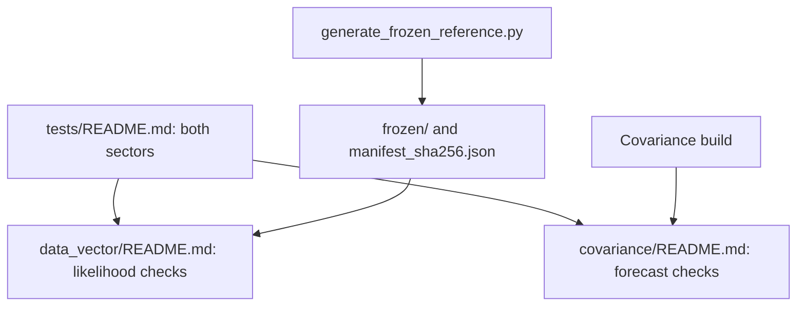

# Tests

The Roman KL tests and optional studies are organized as follows.

- [Data-vector and likelihood checks](data_vector/README.md) cover the project
  predictions, frozen inputs and numerical diagnostics.
- [Covariance checks](covariance/README.md) cover forecast assembly and its
  documented component checks. Covariance generation must be compiled.
- <a name="optional_studies"></a>[Optional studies](studies/README.md#optional_studies)
  compare n(z) reconstructions and numerical accuracy, with plots and
  $\Delta\chi^2$ results. Run them separately from the routine tests.
- [Matter-spectrum emulator comparison](#matter-spectrum-emulator-comparison)
  checks the candidate against CAMB over the cosmological prior.

Read this page, then the guide of each sector. The stored snapshot under
`frozen/` feeds the data-vector checks; the covariance checks need the
covariance build:



The data-vector sector includes the setting-sequence tests
(`data_vector/test_setting_sequences.py`): they change cosmolike
settings in one process, as a notebook does between evaluations, and
compare every result bit for bit with a separate process that saw only
the final settings. A change the loaded data layout cannot follow must
stop with a clear message instead of returning numbers computed from
the earlier settings.

We assume Cocoa and this project are installed, the Cocoa Conda environment
is active, the shell is Bash, and the current folder is `cocoa/Cocoa/`.

> [!WARNING]
> The snapshot was frozen with CAMB installed with the halofit tolerance
> patch. Halofit finds the nonlinear scale by bisection; stock CAMB stops at
> $|\sigma(R) - 1| \le 10^{-3}$ and the patch at $10^{-7}$. The precise
> stopping point moves this survey's galaxy clustering and galaxy-galaxy
> lensing predictions: on stock CAMB the 3x2pt and 2x2pt references move by
> $\Delta\chi^2 = 0.76$ and $0.75$ (measured 2026-11-04), beyond the 0.2
> limit, while cosmic shear moves by 0.009.
>
> `export PATCH_CAMB_HALOFIT_TOLERANCE=1` is set by default in
> `set_installation_options.sh` since 2026-11-08, so a fresh installation
> already has the patched CAMB. An installation made before that, or with
> the key commented out, has stock CAMB; make sure the key is set and
> reinstall CAMB (the setup script re-clones it and applies the patch):
>
> ```bash
> export OVERWRITE_EXISTING_CAMB_CODE=1
> source installation_scripts/setup_camb.sh
> source installation_scripts/compile_camb.sh
> ```

Run the sectors in separate Python invocations: they initialize different
compiled-library state. Running one project at a time also avoids importing
another project's same-named test helpers.

**Step :one:**: activate Cocoa.

```bash
source start_cocoa.sh
```

**Step :two:**: run the data-vector sector.

```bash
python -m pytest ./projects/roman_kl/tests/data_vector
```

**Step :three:**: enable covariance generation.

```bash
unset IGNORE_COSMOLIKE_ROMAN_KL_COVARIANCE
```

**Step :four:**: compile the project.

```bash
source ./projects/roman_kl/scripts/compile_roman_kl.sh
```

**Step :five:**: run the covariance sector.

```bash
python -m pytest ./projects/roman_kl/tests/covariance
```

The project must be enabled in `set_installation_options.sh` before
activation. A covariance skip in a deliberately disabled build is expected;
it is not a successful covariance check. Read the sector guide to distinguish
asserted regressions from advisory accuracy reports.

Frozen configurations and inputs are protected by `manifest_sha256.json`.
Do not regenerate references to silence an unexplained failure. The sector
guides document the deliberate reference-update procedure and its limits.

Hybrid examples can be checked without sampling:

**Step :one:**: check configuration 1.

```bash
python ./projects/roman_kl/EXAMPLE_EMUL2_MINIMIZE1.py --check
```

**Step :two:**: check configuration 2.

```bash
python ./projects/roman_kl/EXAMPLE_EMUL2_MINIMIZE2.py --check
```


## Matter-spectrum emulator comparison

[compare_emulator_camb.py](compare_emulator_camb.py) compares the candidate
matter-spectrum emulator with fresh CAMB predictions at 50 reproducible
cosmologies from `EXAMPLE_EVALUATE1.yaml`. This study reads that live YAML,
not the frozen regression configuration. It retains the example's nuisance
point, mask and covariance, restricts $0.2<\Omega_m<0.5$, and fixes
$\sum m_\nu=0.06$ eV. Both routes use plain `mead2020` and CAMB distances;
the production YAML is not changed. This example uses the total-matter
3x2pt predictions with `include_HOD_GX=0` and `include_halo_IA=0`, so the
hybrid route's approximate cold-matter spectrum does not enter these means.
The candidate nonlinear model is paired with the existing linear emulator;
the comparison therefore tests their combined prediction.

Set `EMULATOR_CODE_DIR` and `EMULATOR_DATA_DIR` to the candidate code and
model checkouts. The model checkout must contain
`emulmps/w0wa_mead2020/emulator_mead2020.keras` and its `metadata.joblib`.
Run from the Cocoa directory with its environment activated.

**Step :one:**: set the CPU allocation. On Linux:

```bash
export OMP_NUM_THREADS=4
export OMP_PROC_BIND=close
export OMP_PLACES=cores
export OMP_DYNAMIC=false
export OPENBLAS_NUM_THREADS=1
export MKL_NUM_THREADS=1
```

On macOS:

```bash
export OMP_NUM_THREADS=4
export OMP_PROC_BIND=disabled
export OMP_PLACES=cores
export OMP_DYNAMIC=false
export OPENBLAS_NUM_THREADS=1
export MKL_NUM_THREADS=1
export VECLIB_MAXIMUM_THREADS=1
```

**Step :two:**: on Linux, keep this comparison on the CPU.

```bash
export CUDA_VISIBLE_DEVICES=""
```

**Step :three:**: run the comparison.

```bash
python projects/roman_kl/tests/compare_emulator_camb.py
```

The script uses the existing shared `cocoa_testing.py` machinery. It saves
points, vectors, failures and the prediction distance
$\Delta\chi^2=\delta m^T C^{-1}\delta m$ under
`chains/matter_emulator_prior/EXAMPLE_EVALUATE1/with_fisher/`. A value below 1 passes the
requested criterion; failures are retained, never replaced by new draws.
`--models`, `--seed` and `--limit` change the test size, reproducible seed and
threshold. BLAS stays at one thread. This comparison does not establish
that posterior importance weights have adequate effective sample size;
that must be checked on the chain used for reweighting.

The saved `camb_loglikes.npy` also shows how each draw fits the supplied
Roman forecast model vector. Compare `-2*(logL - max(logL))` with the
prediction distance to identify errors at poor-fitting draws. The maximum
here is only the best sampled point. These are a fixed-nuisance prior slice,
not posterior samples or a marginalized observational exclusion test.

The Roman KL cosmological priors extend beyond the coordinate ranges in
both emulator metadata files. Keep these draws: this test measures the
candidate over the project's requested prior, including extrapolation.
For interpretation, compare each point with both the linear and nonlinear
scaler bounds. Their seventh coordinate is `w0pwa`: the emulator internally
converts its public `wa` argument to `w + wa` before scaling. Being inside
both bounding boxes does not certify training support or predictive accuracy.

The 24 November 2026 run with seed 137 passed the prediction-distance
criterion at 1 of 50 draws; 20 candidate evaluations were nonfinite. The
30 finite distances had median 4170.95 and maximum $8.72\times10^{22}$.
Among the six draws inside both scaler boxes, five were finite (distances
1.29 to 360.26) and none passed. This combined emulator route therefore
does not meet the requested agreement criterion over this prior sample.

All CAMB predictions were finite, and both routes' saved vectors reproduce
their recorded likelihoods to floating-point precision. Every sampled
cosmology fits the forecast model vector poorly: even the best has
$\chi^2=73515.91$. These results do not establish the error near a forecast
posterior or justify changing the production theory defaults.

### Official hybrid-emulator test and Fisher figure

<!-- hybrid-emulator figure -->
The test draws cosmologies with $w_0>-2$, $1<10^9 A_s\leq 3.5$, $H_0<85$ km/s/Mpc and $0.2<\Omega_m<0.5$, with $m_\nu=0.06$ eV.
The numbered example supplies any tighter priors.
The open symbols show 50 broad draws.
The filled symbols show 25 draws near the example fiducial.
The solid and dashed curves enclose the 68% and 95% regions of the nuisance-marginalized Fisher forecast.


After a later run passes the Fisher convergence check and completes the focused sample,
copy its `fisher/emulator_fisher.png` to `tests/figures/emulator_precision.png` to refresh the published figure.
<!-- end hybrid-emulator figure -->

The command-line driver can distribute independent cosmologies and Fisher
columns over MPI, following the LSST Y1 × DESI Fisher calculation. Use one
project with two ranks and four OpenMP threads per rank.

**Step :one:** Set the thread counts in the activated Cocoa shell.

```bash
export OMP_NUM_THREADS=4
```

```bash
export OPENBLAS_NUM_THREADS=1
```

```bash
export MKL_NUM_THREADS=1
```

**Step :two:** Launch the project's comparison.

```bash
mpirun -n 2 --bind-to none python -m mpi4py \
  projects/roman_kl/tests/compare_emulator_camb.py --mpi --advisory
```

Run one project at a time with this allocation. Each rank owns a separate
model and evaluates different points or derivative columns. OpenMP works
inside each evaluation; BLAS stays at one thread. Rank zero assembles and
writes the combined results. The `--mpi` flag is required: simply launching
the serial driver twice would repeat work and write to the same files.
`python -m mpi4py` also stops the other ranks if an uncaught error terminates
one rank. Plot-only runs use rank zero and need no MPI launch.

The E5 test includes the approved accuracy figure whenever the hybrid
emulator code and networks are installed. No separate plotting flag is
needed. `EMULATOR_CODE_DIR` and `EMULATOR_DATA_DIR` can select candidate
checkouts. This is a long numerical test: it evaluates 50 prior cosmologies
through CAMB and the emulator, computes Fisher derivatives at two step
sizes, and evaluates 25 focused points drawn from the bounded Fisher
distribution. It keeps BLAS at one thread.

**Step :one:**: run the official comparison.

```bash
python -m pytest projects/roman_kl/tests/data_vector/test_emul2.py -k test_e5_hybrid_emulator_fisher
```

Each invocation saves vectors, parameters, provenance, diagnostics and the
PNG/PDF figure in a new directory below `chains/hybrid_emulator_tests/`.
The colors show the direct prediction error
`E = (emulator - CAMB).T @ precision @ (emulator - CAMB)` at thresholds
0.2, 0.5, 1 and 4. Errors from 1 to 4, errors at least 4, and failed
nonfinite predictions have separate categories. Marker shape identifies
the error category; prior points are open and focused points are filled.
Failed predictions use a cross. The title identifies the project. The amplitude
axis stops at 3.5, or at a tighter project bound; this cap does not establish
accuracy throughout the box.

The default Fisher calculation uses `EXAMPLE_EVALUATE1.yaml`: its own
fiducial point, cosmic-shear data vector, mask, covariance and sampled
cosmological and source nuisance parameters. The emulator errors use this
same observable. These are project-specific forecasts, not a copy of the
DES Y6 contour. The synthetic vector was built with the example's theory
choice; matching both test routes to plain `mead2020` need not give zero
chi-squared against that stored vector.

The focused cosmological points are drawn from the bounded Fisher after
marginalizing its nuisance parameters. Both accuracy samples keep nuisance
inputs fixed at the example values. Their predictions and errors are saved
under `local/` for the focused sample; the errors are evaluated through
both theory routes, not inferred from the Fisher approximation.
An optional `--local-points` named-column table replaces the generated
focused sample and is recomputed through both theory routes.

The Fisher calculation includes Gaussian prior curvature and applies hard
bounds before marginalizing the plotted pairs. Solid/dashed contours enclose
68/95 percent of this centered local approximation; they are not measured
posterior contours. Insufficient bounded-sample convergence fails the test.
For NLA, the quadratic-alignment amplitude and slope and the density-weighting
amplitude are absent from the prediction at every parameter value. Their
independent priors integrate to constants, so these parameters are omitted
from the Fisher integral. Other zero-response directions retain their
bounds: a vanishing local derivative need not imply global independence.

Large prediction errors and individual nonfinite emulator predictions are
reported as advisory results. Missing CAMB references, no valid comparisons,
or an incomplete Fisher/plot calculation fail the test. Frozen regression
references and production theory choices are not changed.

**Step :two:**: to redraw a completed run, set `EMULATOR_COMPARISON_DIR`
to its directory:

```bash
python projects/roman_kl/tests/compare_emulator_camb.py --plot-only "$EMULATOR_COMPARISON_DIR"
```

Add `--resample-fisher --fisher-sample-power 20` to repeat only the bounded
integration with more samples. `--no-fisher` is available in the standalone
driver for a prediction-only diagnostic; E5 does not use it. The driver
supports `--models`, `--seed`, `--points` and `--output` for explicit studies.
Its `--advisory` flag is used by E5; without it, accuracy exceedances also
produce a nonzero exit code.
