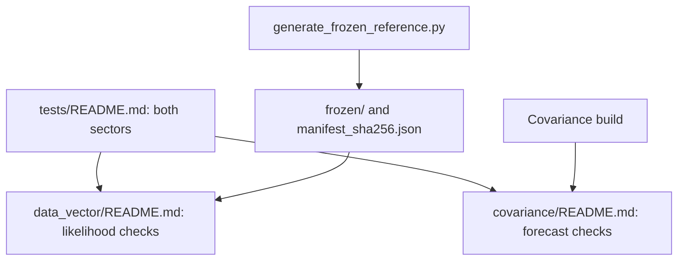
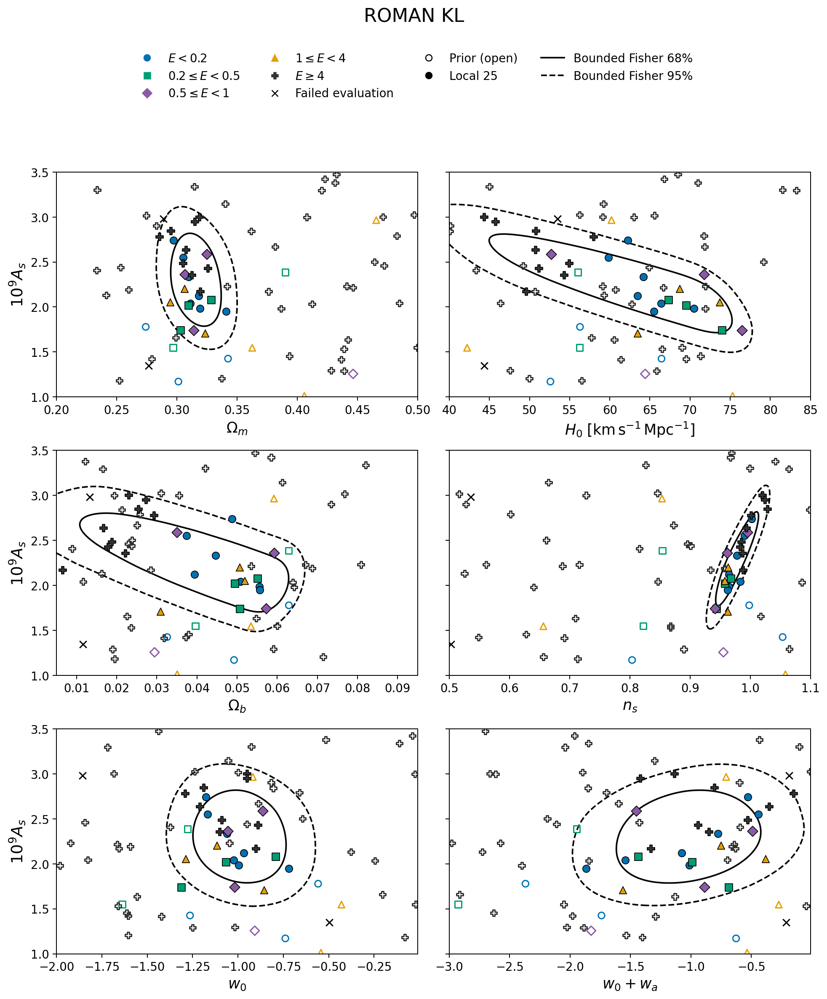

# Tests

The Roman KL tests and optional studies are organized as follows.

- [Data-vector and likelihood checks](data_vector/README.md) cover the project
  predictions, frozen inputs and numerical diagnostics.
- [Covariance checks](covariance/README.md) cover forecast assembly and its
  documented component checks. Covariance generation must be compiled.
- <a name="optional_studies"></a>[Optional studies](studies/README.md#optional_studies)
  compare n(z) reconstructions and numerical accuracy, with plots and
  $\Delta\chi^2$ results. Run them separately from the routine tests.
- [Matter-spectrum emulator comparison](#matter-spectrum-emulator-comparison)
  checks the candidate against CAMB over the cosmological prior.

Read this page, then the guide of each sector. The stored snapshot under
`frozen/` feeds the data-vector checks; the covariance checks need the
covariance build:



The data-vector sector includes the setting-sequence tests
(`data_vector/test_setting_sequences.py`): they change cosmolike
settings in one process, as a notebook does between evaluations, and
compare every result bit for bit with a separate process that saw only
the final settings. A change the loaded data layout cannot follow must
stop with a clear message instead of returning numbers computed from
the earlier settings.

We assume Cocoa and this project are installed, the Cocoa Conda environment
is active, the shell is Bash, and the current folder is `cocoa/Cocoa/`.

> [!WARNING]
> The snapshot was frozen with CAMB installed with the halofit tolerance
> patch. Halofit finds the nonlinear scale by bisection; stock CAMB stops at
> $|\sigma(R) - 1| \le 10^{-3}$ and the patch at $10^{-7}$. The precise
> stopping point moves this survey's galaxy clustering and galaxy-galaxy
> lensing predictions: on stock CAMB the 3x2pt and 2x2pt references move by
> $\Delta\chi^2 = 0.76$ and $0.75$ (measured 2026-11-04), beyond the 0.2
> limit, while cosmic shear moves by 0.009.
>
> `export PATCH_CAMB_HALOFIT_TOLERANCE=1` is set by default in
> `set_installation_options.sh` since 2026-11-08, so a fresh installation
> already has the patched CAMB. An installation made before that, or with
> the key commented out, has stock CAMB; make sure the key is set and
> reinstall CAMB (the setup script re-clones it and applies the patch):
>
> ```bash
> export OVERWRITE_EXISTING_CAMB_CODE=1
> source installation_scripts/setup_camb.sh
> source installation_scripts/compile_camb.sh
> ```

Run the sectors in separate Python invocations: they initialize different
compiled-library state. Running one project at a time also avoids importing
another project's same-named test helpers.

**Step :one:**: activate Cocoa.

```bash
source start_cocoa.sh
```

**Step :two:**: run the data-vector sector.

```bash
python -m pytest ./projects/roman_kl/tests/data_vector
```

**Step :three:**: enable covariance generation.

```bash
unset IGNORE_COSMOLIKE_ROMAN_KL_COVARIANCE
```

**Step :four:**: compile the project.

```bash
source ./projects/roman_kl/scripts/compile_roman_kl.sh
```

**Step :five:**: run the covariance sector.

```bash
python -m pytest ./projects/roman_kl/tests/covariance
```

The project must be enabled in `set_installation_options.sh` before
activation. A covariance skip in a deliberately disabled build is expected;
it is not a successful covariance check. Read the sector guide to distinguish
asserted regressions from advisory accuracy reports.

Frozen configurations and inputs are protected by `manifest_sha256.json`.
Do not regenerate references to silence an unexplained failure. The sector
guides document the deliberate reference-update procedure and its limits.

Hybrid examples can be checked without sampling:

**Step :one:**: check configuration 1.

```bash
python ./projects/roman_kl/EXAMPLE_EMUL2_MINIMIZE1.py --check
```

**Step :two:**: check configuration 2.

```bash
python ./projects/roman_kl/EXAMPLE_EMUL2_MINIMIZE2.py --check
```


## Matter-spectrum emulator comparison

[compare_emulator_camb.py](compare_emulator_camb.py) compares the candidate
matter-spectrum emulator with fresh CAMB predictions at the saved 50
broad and 25 focused cosmologies. Its fixed [benchmark](fisher_reference/)
supplies the nuisance point, mask and covariance, enforces $0.2<\Omega_m<0.5$,
and fixes
$\sum m_\nu=0.06$ eV. Both routes use plain `mead2020` and CAMB distances;
the production YAML is not changed. This example uses the total-matter
3x2pt predictions with `include_HOD_GX=0` and `include_halo_IA=0`, so the
hybrid route's approximate cold-matter spectrum does not enter these means.
The candidate nonlinear model is paired with the existing linear emulator;
the comparison therefore tests their combined prediction.

Set `EMULATOR_CODE_DIR` and `EMULATOR_DATA_DIR` to the candidate code and
model checkouts. The model checkout must contain
`emulmps/w0wa_mead2020/emulator_mead2020.keras` and its `metadata.joblib`.
Run from the Cocoa directory with its environment activated.

**Step :one:**: set the CPU allocation. On Linux:

```bash
export OMP_NUM_THREADS=4
export OMP_PROC_BIND=close
export OMP_PLACES=cores
export OMP_DYNAMIC=false
export OPENBLAS_NUM_THREADS=1
export MKL_NUM_THREADS=1
```

On macOS:

```bash
export OMP_NUM_THREADS=4
export OMP_PROC_BIND=disabled
export OMP_PLACES=cores
export OMP_DYNAMIC=false
export OPENBLAS_NUM_THREADS=1
export MKL_NUM_THREADS=1
export VECLIB_MAXIMUM_THREADS=1
```

**Step :two:**: on Linux, keep this comparison on the CPU.

```bash
export CUDA_VISIBLE_DEVICES=""
```

**Step :three:**: run the comparison.

```bash
python projects/roman_kl/tests/compare_emulator_camb.py
```

The script uses the existing shared `cocoa_testing.py` machinery. It saves
points, vectors, failures and the prediction distance
$\Delta\chi^2=\delta m^T C^{-1}\delta m$ under
a timestamped directory below `chains/matter_emulator_points/`. A value below 1 passes the
requested criterion; failures are retained, never replaced by new draws.
`--models`, `--seed` and `--limit` change the test size, reproducible seed and
threshold. BLAS stays at one thread. This comparison does not establish
that posterior importance weights have adequate effective sample size;
that must be checked on the chain used for reweighting.

The saved `camb_loglikes.npy` also shows how each draw fits the supplied
Roman forecast model vector. Compare `-2*(logL - max(logL))` with the
prediction distance to identify errors at poor-fitting draws. The maximum
here is only the best sampled point. These are a fixed-nuisance prior slice,
not posterior samples or a marginalized observational exclusion test.

The Roman KL cosmological priors extend beyond the coordinate ranges in
both emulator metadata files. Keep these draws: this test measures the
candidate over the project's requested prior, including extrapolation.
For interpretation, compare each point with both the linear and nonlinear
scaler bounds. Their seventh coordinate is `w0pwa`: the emulator internally
converts its public `wa` argument to `w + wa` before scaling. Being inside
both bounding boxes does not certify training support or predictive accuracy.

The 24 November 2026 run with seed 137 passed the prediction-distance
criterion at 1 of 50 draws; 20 candidate evaluations were nonfinite. The
30 finite distances had median 4170.95 and maximum $8.72\times10^{22}$.
Among the six draws inside both scaler boxes, five were finite (distances
1.29 to 360.26) and none passed. This combined emulator route therefore
does not meet the requested agreement criterion over this prior sample.

All CAMB predictions were finite, and both routes' saved vectors reproduce
their recorded likelihoods to floating-point precision. Every sampled
cosmology fits the forecast model vector poorly: even the best has
$\chi^2=73515.91$. These results do not establish the error near a forecast
posterior or justify changing the production theory defaults.

### Hybrid-emulator accuracy test

<!-- hybrid-emulator figure -->
The CAMB reference uses the saved benchmark's standard numerical controls and one
massive neutrino at $m_\nu=0.06$ eV. The same fixed tables supply 50 broad
points (open) and 25 focused points (filled) to both model routes.
The tables intersect the benchmark support with $0.2<\Omega_m<0.5$,
$1<10^9 A_s\le 3.5$, $H_0<85$ km/s/Mpc, $w_0>-2$ and
$\Omega_b(H_0/100)^2<0.035$. The solid and dashed curves show the saved
68% and 95% nuisance-marginalized Fisher regions.

CAMB uses `AccuracyBoost: 1.05`, `k_per_logint: 50` and `kmax: 10`. The saved
Fisher diagnostic found a maximum FoM shift of 0.26%.



Counts use the thresholds 0.2, 0.5, 1 and 4 in that order.

| Case | Broad below threshold (50) | Focused below threshold (25) | Nonfinite broad/focused |
| --- | --- | --- | --- |
| Roman KL | 3/5/5/9 | 7/11/14/16 | 2/0 |

CAMB completed all 50 broad predictions. The candidate reported a floating-point
overflow and a nonfinite likelihood at broad table rows 8 and 20. Both points
are within the benchmark cuts and extend beyond the emulator's training
scaler bounds in several coordinates.

<!-- end hybrid-emulator figure -->

E5 reads the saved `benchmark.yaml` in [fisher_reference/](fisher_reference/).
The benchmark fixes the likelihood, data selection, sampled parameters,
fiducial and normal numerical controls.

The accuracy test evaluates CAMB and the candidate at the fixed
[50 broad and 25 focused points](fisher_reference/) and stores both
vectors, the covariance-weighted error, and point status. Nuisance inputs are
held at the evaluate fiducial. Missing CAMB predictions or a comparison
with no valid vectors fails E5. The E5 adapter treats large prediction errors
as advisory. The strict standalone command also checks the error threshold.

```bash
python -m pytest projects/roman_kl/tests/data_vector/test_emul2.py -k e5
```

To distribute the numerical comparisons across two MPI ranks with four
OpenMP threads each, use the same driver directly from activated Cocoa.
Keep BLAS at one thread and pass `--mpi` so the ranks own different points.

```bash
OMP_NUM_THREADS=4 OPENBLAS_NUM_THREADS=1 MKL_NUM_THREADS=1 \
  VECLIB_MAXIMUM_THREADS=1 mpirun -n 2 --bind-to none python -m mpi4py \
  projects/roman_kl/tests/compare_emulator_camb.py --mpi --advisory
```

Saved Fisher contours show the bounded 68% and 95% regions of a centered
CAMB forecast with nuisance parameters marginalized. The saved reference
records the matrix, priors, fiducial, selection and numerical diagnostics.
The accuracy run uses the available saved contour for display. Prediction
errors remain valid when the saved contour is absent or marked unreliable. `--fisher-reference` selects a saved directory, and
`--no-fisher` omits the display. Candidate networks can be changed using
`EMULATOR_CODE_DIR` and `EMULATOR_DATA_DIR`.

```bash
python projects/roman_kl/tests/compare_emulator_camb.py --plot-only /path/to/run
```

### Separate FoM screen

```bash
OMP_NUM_THREADS=4 OPENBLAS_NUM_THREADS=1 MKL_NUM_THREADS=1 \
  VECLIB_MAXIMUM_THREADS=1 mpirun -n 2 --bind-to none python -m mpi4py \
  projects/roman_kl/tests/check_fom_convergence.py --mpi
```

The FoM screen builds the full CAMB baseline once. Each nonzero coordinate
uses `h = 0.025 * abs(fiducial)`, capped when needed to keep both
`±2h` stencil points within the prior. Zero-centered coordinates use
their configured absolute step, or one tenth of their proposal width.
The archive records every actual step. Fourth differences at that one
spacing rank the numerical noise contributions. Only the selected
columns run at higher accuracy; the output records the omitted columns
and the estimated FoM shift. This command is independent of E5.

Use `--save-fisher-contours` to explicitly integrate and store a bounded
contour for later accuracy plots. The calculation writes the reference to
`reference/` under its output directory. `--validate-fisher-steps` opts
into the more expensive full comparison at two stencil spacings and multiple
accuracy settings.
