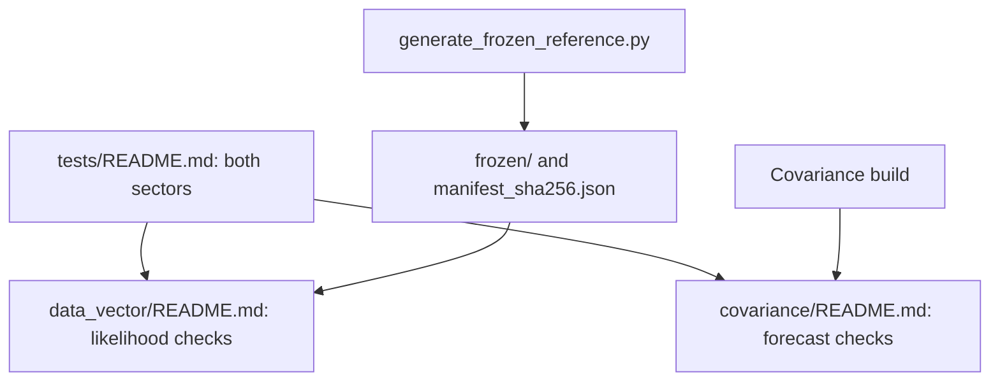

# Tests

The Roman KL tests and optional studies are organized as follows.

- [Data-vector and likelihood checks](data_vector/README.md) cover the project
  predictions, frozen inputs and numerical diagnostics.
- [Covariance checks](covariance/README.md) cover forecast assembly and its
  documented component checks. Covariance generation must be compiled.
- <a name="optional_studies"></a>[Optional studies](studies/README.md#optional_studies)
  compare n(z) reconstructions and numerical accuracy, with plots and
  $\Delta\chi^2$ results. Run them separately from the routine tests.

Read this page, then the guide of each sector. The stored snapshot under
`frozen/` feeds the data-vector checks; the covariance checks need the
covariance build:



The data-vector sector includes the setting-sequence tests
(`data_vector/test_setting_sequences.py`): they change cosmolike
settings in one process, as a notebook does between evaluations, and
compare every result bit for bit with a separate process that saw only
the final settings. A change the loaded data layout cannot follow must
stop with a clear message instead of returning numbers computed from
the earlier settings.

We assume Cocoa and this project are installed, the Cocoa Conda environment
is active, the shell is Bash, and the current folder is `cocoa/Cocoa/`.

> [!WARNING]
> The snapshot was frozen with CAMB installed with the halofit tolerance
> patch. Halofit finds the nonlinear scale by bisection; stock CAMB stops at
> $|\sigma(R) - 1| \le 10^{-3}$ and the patch at $10^{-7}$. The precise
> stopping point moves this survey's galaxy clustering and galaxy-galaxy
> lensing predictions: on stock CAMB the 3x2pt and 2x2pt references move by
> $\Delta\chi^2 = 0.76$ and $0.75$ (measured 2026-11-04), beyond the 0.2
> limit, while cosmic shear moves by 0.009.
>
> `export PATCH_CAMB_HALOFIT_TOLERANCE=1` is set by default in
> `set_installation_options.sh` since 2026-11-08, so a fresh installation
> already has the patched CAMB. An installation made before that, or with
> the key commented out, has stock CAMB; make sure the key is set and
> reinstall CAMB (the setup script re-clones it and applies the patch):
>
> ```bash
> export OVERWRITE_EXISTING_CAMB_CODE=1
> source installation_scripts/setup_camb.sh
> source installation_scripts/compile_camb.sh
> ```

Run the sectors in separate Python invocations: they initialize different
compiled-library state. Running one project at a time also avoids importing
another project's same-named test helpers.

**Step :one:**: activate Cocoa.

```bash
source start_cocoa.sh
```

**Step :two:**: run the data-vector sector.

```bash
python -m pytest ./projects/roman_kl/tests/data_vector
```

**Step :three:**: enable covariance generation.

```bash
unset IGNORE_COSMOLIKE_ROMAN_KL_COVARIANCE
```

**Step :four:**: compile the project.

```bash
source ./projects/roman_kl/scripts/compile_roman_kl.sh
```

**Step :five:**: run the covariance sector.

```bash
python -m pytest ./projects/roman_kl/tests/covariance
```

The project must be enabled in `set_installation_options.sh` before
activation. A covariance skip in a deliberately disabled build is expected;
it is not a successful covariance check. Read the sector guide to distinguish
asserted regressions from advisory accuracy reports.

Frozen configurations and inputs are protected by `manifest_sha256.json`.
Do not regenerate references to silence an unexplained failure. The sector
guides document the deliberate reference-update procedure and its limits.

Hybrid examples can be checked without sampling:

**Step :one:**: check configuration 1.

```bash
python ./projects/roman_kl/EXAMPLE_EMUL2_MINIMIZE1.py --check
```

**Step :two:**: check configuration 2.

```bash
python ./projects/roman_kl/EXAMPLE_EMUL2_MINIMIZE2.py --check
```
