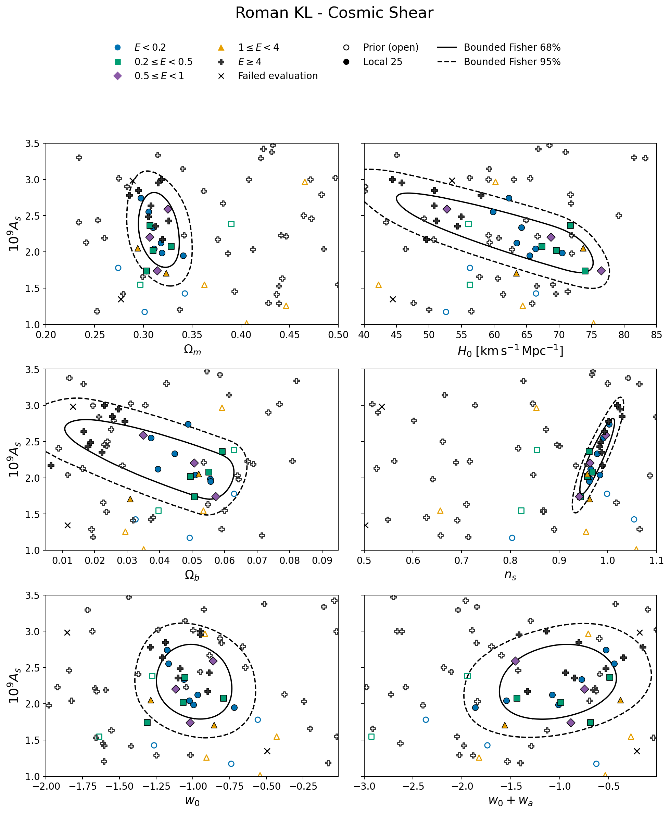

# Unit tests for the likelihoods

The frozen snapshot `frozen/` and its manifest `manifest_sha256.json`
live in the parent `tests/` directory; the paths below are relative to
it.

These tests catch two kinds of silent breakage: a $\chi^2$ that drifted
because code or data changed by accident, and a race condition (a bug
where evaluating several points in a row corrupts a later result
through leftover internal state or colliding OpenMP threads). These
tests also measure the accuracy of the hybrid emulated pipelines and
report whether they are accurate enough for data analysis (advisory:
no pass/fail).

Every model build runs in its own worker subprocess: example1 and
example2 use data sets with different mask and covariance dimensions,
and the cosmolike C layer aborts the whole process when a second
configuration with different dimensions initializes after the first.
The isolation is internal; the commands below stay the same.

The mechanism of every shared check family - the frozen-reference and
race contract, the zero-baseline construction, the sweeps and their
`--high`/`--mask` options, the accuracy settings and their meanings -
is documented once in
[the shared data-vector checks](https://github.com/CosmoLike/cocoa-cosmolike-core/blob/main/README.md#dv_checks)
of the CosmoLike core. This file records what the Roman
kinematic-lensing project (roman_kl) runs and what it measured.

# Table of contents

1. [Running the tests](#run_tests)
2. [The tests](#the_tests)
    1. [The CFASTPT vs FASTPT comparison](#cfastpt_fastpt)
    2. [The Halofit vs EE2 checks](#halofit_ee2)
    3. [The EE2 race test](#ee2_race)
    4. [Advisory checks](#advisory_checks)
    5. [Accuracy checks](#accuracy_checks)
    6. [Baryonic feedback checks](#baryon_checks)
    7. [The photo-z convention checks](#photoz_conventions)
    8. [The non-Limber checks](#nonlimber_checks)
    9. [The sector-ladder cache check](#cache_ladder)
    10. [The non-Limber early-exit tolerance checks](#nonlimber_tolerance)
    11. [The non-Limber radial grid](#nonlimber_grid)
3. [Hybrid-emulator accuracy test](#hybrid-emulator-accuracy-test)
4. [FoM convergence](#fom-convergence)
5. [Appendix](#appendix)
    1. [FAQ: What does this project's snapshot hold?](#frozen_copy)
    2. [FAQ: How can maintainers refresh the snapshot?](#refreeze)

## Running the tests <a name="run_tests"></a>

We assume users are in the Conda cocoa environment from a previous
`conda activate cocoa` command, that the shell is bash, and that the
current folder is the cocoa main folder `cocoa/Cocoa`. Every command
below assumes `start_cocoa.sh` has been sourced once:

    source start_cocoa.sh

Run the full suite with

    python -m pytest ./projects/roman_kl/tests/data_vector

or, without pytest,

    python -m unittest discover -s ./projects/roman_kl/tests -v

The tests change no project files. Each test prints a progress line per
model build and per evaluation, then a report with the computed $\chi^2$,
the stored reference, the difference, and the pass limit. A full run
performs about 173 likelihood evaluations and takes a few minutes. The test
files set their OpenMP worker count before imports.

The shared likelihood tests default to four OpenMP workers. For six workers,
set `COCOA_TEST_OMP_THREADS=6` and `OMP_THREAD_LIMIT=6` before
starting Python. The entry points copy the test setting to
`OMP_NUM_THREADS` before importing native libraries. Keep BLAS at
one worker. A smaller OpenMP thread limit can reduce the actual team
below the requested count.

## The tests <a name="the_tests"></a>

The standard configurations get four tests each - the frozen-reference
drift check and the race check, in NLA and in TATT
([mechanism](https://github.com/CosmoLike/cocoa-cosmolike-core/blob/main/README.md#dv_frozen)).
The TATT variants set

    IA_model: 1
    ROMAN_KL_A2_1: 0.05
    ROMAN_KL_BTA_1: 0.05
    ROMAN_KL_A2_2: -1.51541

The suite follows the shared
[test-file naming convention](https://github.com/CosmoLike/cocoa-cosmolike-core/blob/main/README.md#dv_naming): a file name
means the same thing in every project. This project's
configurations and test numbers:

| file | configuration | tests |
|---|---|---|
| `test_example1.py` | cosmic shear | 1-4 |
| `test_example2.py` | 3x2pt | 5-8 |
| `test_example2_2x2pt.py` | 2x2pt (`roman_kl.combo_2x2pt`) | 11-14 |
| `test_fastpt.py` | the sweep: shear; 3x2pt; 2x2pt (`roman_kl.combo_2x2pt`) | 15, 16, 17 |
| `test_ee2.py` | race | 18 |

Tests 9 and 10 are not used: the numbering follows the shared
convention, where they are the frozen FAST-PT reference checks
this project does not ship.

### The CFASTPT vs FASTPT comparison (`test_fastpt.py`, tests 15-17) <a name="cfastpt_fastpt"></a>

The sweep mechanism, the zero-baseline construction and the
`--high`/`--mask` options are in
[the shared checks](https://github.com/CosmoLike/cocoa-cosmolike-core/blob/main/README.md#dv_fastpt).
Here, test 15 runs the sweep on cosmic shear, test 16 on the 3x2pt
likelihood and test 17 on the 2x2pt likelihood (galaxy clustering
plus galaxy-galaxy lensing, cosmic shear dropped). In test 16 the
frozen configuration fixes the one-loop bias amplitudes
(`ROMAN_KL_B2_*`, `ROMAN_KL_B3NL_*`) at zero, so the sweep scores the
intrinsic-alignment tables alone on the wider data vector; in test 17
clustering carries no intrinsic alignment, so the TATT tables are
scored through galaxy-galaxy lensing alone.

The masks `--mask` accepts here are `frozen` (each example's contract
mask, the default) and `ones` (every data point kept). The 3x2pt
frozen mask is already the all-ones mask (all 2,200 entries 1.0), so
`--mask=ones` reproduces the frozen numbers in tests 16 and 17 by
construction; in test 15 it weights the deviation with the full
3,300-dimension inverse covariance (every row unmasked) instead of
the shear-block masked inverse.

> [!NOTE]
> Before the two-grid upgrade of the fastpt theory block (2026-09)
> there was no upsampling and the difference reached
> $\Delta\chi^2 = 26409$ across the prior.

The point values, the design, and the decision record live with the
lsst_y1 project (its tests/README.md carries the full discussion);
the table below is this project's own measurement:

| output table (points) | internal grid (points) | max $\Delta\chi^2$ | Runtime / first row |
|---|---|---|---|
| 1,100 | 1,100 (shared) | 26409 | 1.00 |
| 1,024,900 (`accuracyboost: 1`, the default) | 1,100 (the default) | 0.1886 | 1.15 |
| 2,048,900 (`accuracyboost: 2`) | 1,300 (`internal_accuracyboost: 2`) | 0.1804 | 1.35 |
| 4,096,900 | 1,100 | 0.177 | 1.70 |
| 8,192,900 | 1,100 | 0.175 | 2.30 |

Runtime ratios use the first row of this table as the baseline, with the
same timed scope and machine. They compare sampling costs within this
project; absolute runtimes depend on the machine.


> [!NOTE]
> The fastpt defaults hold the band on their own. The sweep also
> measured a residual floor near 0.175 that further density does
> not move - the one project where a difference beyond the table
> density is visible, safely inside the band. cfastpt
> (`IA_code: 0`) remains the reference implementation.

Measured on 2026-09-23:

- Test 16 (3x2pt): max $\Delta\chi^2 = 0.174298$ at the default
  camb/cosmolike settings and 0.077547 with `--high=1` (advisory
  doubled-grid columns 0.165475 and 0.051343).
- Test 17 (2x2pt): max $\Delta\chi^2 = 0.000012$ at the default
  settings and 0.000004 with `--high=1`: next to tests 15 and 16,
  essentially all of the implementation difference sits in the
  cosmic-shear block.
- Every `--mask=ones` sweep passed and reproduced its frozen-mask
  numbers at the printed six decimals: test 15 measured max
  $\Delta\chi^2 = 0.188561$ at the default settings (0.076974 with
  `--high=1`).
- At the all-zero IA point the two implementations printed identical
  data vectors on every unmasked row ($\Delta\chi^2 = 0.000000$).

Run the comparison at the default camb/cosmolike settings, at the
pushed settings (the full comparison is both invocations), and with
every data point kept:

    python -m pytest ./projects/roman_kl/tests/data_vector/test_fastpt.py
    python -m pytest ./projects/roman_kl/tests/data_vector/test_fastpt.py --high=1
    python -m pytest ./projects/roman_kl/tests/data_vector/test_fastpt.py --mask=ones

### The Halofit vs EE2 checks (`test_nonlinear.py`, NL1-NL2) <a name="halofit_ee2"></a>

[Mechanism](https://github.com/CosmoLike/cocoa-cosmolike-core/blob/main/README.md#dv_halofit_ee2):
NL1 evaluates the cosmic-shear data vector and NL2 the 3x2pt one,
each with both nonlinear-power sources at the ten shared cosmologies
(halofit, `non_linear_emul: 2`, is the frozen contracts' setting).
The `--mask` option applies (`frozen` and `ones`). Measured on
2026-09-23 (the figure below, frozen mask):

- NL1 (cosmic shear): per-cosmology $\Delta\chi^2$ between 8.8 and
  491.2 (median 64.4), largest at the high-omegam draws; under
  `--mask=ones` (the full 3,300-dimension inverse covariance, every
  row unmasked) the run reproduced the frozen numbers at the printed
  four decimals: max $\Delta\chi^2 = 491.2244$, median 64.4280.
- NL2 (3x2pt): between 375.0 and 3,092.8 (median 911.8); the frozen
  3x2pt mask is already the all-ones mask, so `--mask=ones`
  reproduces the frozen numbers by construction; the run printed
  identical digits.


### The EE2 race test (`test_ee2.py`, test 18) <a name="ee2_race"></a>

[Mechanism](https://github.com/CosmoLike/cocoa-cosmolike-core/blob/main/README.md#dv_ee2):
the gate that compiles the pre-modification EuclidEmulator2 build
(commit `ff59f66`) and compares the two builds' data vectors runs as
the lsst_y1 project's test 18 (its `tests/test_ee2.py`) and is not
repeated here. This project's test 18 is the race check with EE2 on
(`non_linear_emul: 1`). Measured on 2026-09-23:

- Test 18: the fresh and 10th-in-a-row fiducial agree to all eight
  printed decimals.
- The pre-modification build, compiled side by side and evaluated at
  the ten cosmologies of the Halofit-vs-EE2 checks on this project's
  cosmic shear under its frozen mask, measured max
  $\Delta\chi^2 = 1.1\times10^{-4}$ against the installed build (max
  fractional data-vector difference $2.7\times10^{-5}$).

### Advisory checks (`test_emul2.py`, E1-E4) <a name="advisory_checks"></a>

These checks test the hybrid emulators: trained machine-learning
networks replace the Boltzmann code. There is no pass/fail; each
check prints four quantities:

| printed quantity | meaning |
|---|---|
| emulator $\chi^2$ | the emulated pipeline evaluated at the fiducial point |
| drift | change against the stored emulator reference; nonzero means the installed emulator no longer reproduces its stored $\chi^2$ |
| $\lvert\chi^2_\text{emulator} - \chi^2_\text{non-emulated}\rvert$ | the difference against the non-emulated $\chi^2$ at the same cosmology |
| verdict | agrees at this configuration when $\lvert\chi^2_\text{emulator} - \chi^2_\text{non-emulated}\rvert < 0.2$, does not agree otherwise |

A race-condition check (OpenMP threading) runs as well, warning
instead of failing.

Each emulated configuration evaluates the same synthetic NLA vector
as its exact counterpart, where the exact reference $\chi^2$ is
0.000000 by construction. The error above therefore compares the two
pipelines on identical data; the shipped EMUL2 modelvectors are not
used.

> [!NOTE]
> The trained-network files are read from
> `external_modules/data/emultrf`, not from the `frozen/` snapshot; the
> network device is pinned to `cpu` so the numbers do not depend on
> GPU availability.

Run them on their own:

    python -m pytest ./projects/roman_kl/tests/data_vector/test_emul2.py

### Accuracy checks (`test_accuracy.py`, A1-A6) <a name="accuracy_checks"></a>

[Mechanism, setting meanings and cost order](https://github.com/CosmoLike/cocoa-cosmolike-core/blob/main/README.md#dv_accuracy):
check A0, which runs first, raises one setting at a time on the 3x2pt
NLA configuration (including `accuracyboost: 5` as a stress test);
A1-A6 re-evaluate cosmic shear, 3x2pt and 2x2pt, in NLA and TATT,
with every setting pushed at once. This project's pushed values:

| setting | raised to |
|---------|-----------|
| `accuracyboost` (cosmolike) | 3 |
| `integration_accuracy` (cosmolike) | 10 |
| `internal_accuracyboost` (cosmolike) | 2 |
| `kmax_boltzmann` (cosmolike) | 40 |
| `AccuracyBoost` (CAMB) | 2 |
| `k_per_logint` (CAMB) | 50 |
| `kmax` (CAMB) | 50 |

There is no `lmax` entry here: the ell range lives in the dataset.
The nested-grid construction `accuracyboost` refines is commented in
`likelihood/_cosmolike_prototype_base.py`.

The likelihood yamls set `internal_accuracyboost: 1`, which keeps the
convolution grid equal to the output table: the exact single-grid
path. Coarser grids also hold: the lsst_y1 scan of this setting
measured $`\Delta^T C^{-1} \Delta \le 10^{-9}`$ against the single-grid
path down to `internal_accuracyboost: 0.27`.

#### Why these accuracy defaults? <a name="accuracy_defaults"></a>

The examples default to `k_per_logint: 50`: the old default
undersampled the CAMB transfer functions, and that error masqueraded
as an apparent CAMB `AccuracyBoost` sensitivity until the transfer
sampling was raised.

Run them on their own, or skip them (high-accuracy evaluations take
minutes):

    python -m pytest ./projects/roman_kl/tests/data_vector/test_accuracy.py
    python -m pytest ./projects/roman_kl/tests --ignore ./projects/roman_kl/tests/data_vector/test_accuracy.py

### Baryonic feedback checks (`test_accuracy_baryons.py`, BF1-BF7; `test_baryons.py`, BD1-BD7) <a name="baryon_checks"></a>

[Mechanism](https://github.com/CosmoLike/cocoa-cosmolike-core/blob/main/README.md#dv_baryons):
the accuracy checks (BF) report the default-versus-pushed
$\Delta\chi^2$ with each feedback method on, one advisory check per
method; check BF0 additionally runs the one-setting-at-a-time scan
with the Akino SP(k) feedback on, so a large delta names the setting
causing it. The drift tests (BD) pin each method's frozen prediction
(`generate_frozen_reference.py --baryons`), one test per method.

Every checked configuration is measurable by construction: the
BACCOemu check evaluates with `omegab: 0.049`, inside that emulator's
baryon-density training box, whose floor sits exactly above the
fiducial `omegab: 0.04`; and the double-power-law point is chosen to
keep the baryon fraction inside SP(k)'s calibrated band over the full
redshift grid.

Run them with

    python -m pytest ./projects/roman_kl/tests/data_vector/test_accuracy_baryons.py
    python -m pytest ./projects/roman_kl/tests/data_vector/test_baryons.py

### The photo-z convention checks (`test_photoz_conventions.py`) <a name="photoz_conventions"></a>

[Mechanism](https://github.com/CosmoLike/cocoa-cosmolike-core/blob/main/README.md#dv_photoz):
the frozen cosmic-shear fiducial under the default, each alternative
convention, and the default again. Measured on 2026-09-25:

- default: $\chi^2 = 0.000000$ (the frozen reference exactly).
- linear: $\Delta\chi^2 = 2.0\times10^{-5}$; Steffen:
  $\Delta\chi^2 = 1.5\times10^{-6}$. Either interpolant change is far below
  the survey's statistical precision.
- Z_MID: $\Delta\chi^2 = 2.35$ - the half-bin z-column reading
  is the one photo-z convention that matters at this precision.

The figures below are regenerated by
`generate_photoz_convention_figure.py`:


### The non-Limber checks (`test_nonlimber_ggl.py`, `test_nonlimber_gg.py`) <a name="nonlimber_checks"></a>

[Mechanism](https://github.com/CosmoLike/cocoa-cosmolike-core/blob/main/README.md#dv_nonlimber):
`adopt_limber_gs` and `adopt_limber_gg` are both `0` (the exact
projection below the cap `lmax_nonlimber: 200`) in this project,
because the measured differences below are too large to absorb. In this project's
Fourier-space data vector each band center takes its Limber value
plus the non-Limber correction interpolated linearly between the two
integer multipoles around it.

Galaxy-galaxy lensing, measured on 2026-10-01
(`nonlimber_accuracyboost: 4`):

- $\Delta\chi^2 = 0.103$ for the 3x2pt data vector (the test pins
  0.1029 to 5%).
- The largest single-pair contributions (each pair's block alone) are
  (5,6), (4,5), (6,7), (3,4) with 0.024, 0.024, 0.022, 0.020: each
  lens bin with the source bin right behind it.
- On 2026-09-28 the default switched from Limber to the exact
  projection: the $\Delta\chi^2 = 1.63$ measured on 2026-09-27 was
  judged too large to absorb. The shipped data vector was regenerated
  with the non-Limber default and the frozen references were refrozen
  from it.
- That 1.63 was mostly the numerical error of the exact projection,
  not the Limber error: the non-Limber chi grid had 512 points
  (`nonlimber_accuracyboost: 1`), too few for the narrow lens bins.
  With today's code the same comparison gives 1.42, 0.100 and 0.103
  at 512, 1024 and 2048 points (measured 2026-10-01).

Galaxy clustering, measured on 2026-10-01
(`nonlimber_accuracyboost: 4`):

- $\Delta\chi^2 = 46.9$ for the 3x2pt data vector (the test pins
  46.89 to 5% at the production cap 200), against 0.103 for the same
  comparison in galaxy-galaxy lensing.
- The largest contributions are lens bins 6, 7, 5, 4 with 7.6, 7.5,
  7.1, 6.2 (each bin's block alone).
- 57.4 on 2026-09-28, when the non-Limber chi grid had 512 points
  (`nonlimber_accuracyboost: 1`) and cosmolike's 1% early exit
  truncated the correction: the narrow lens bins need 2048 points (the
  3x2pt $\chi^2$ moves by 8.4, 0.09, $10^{-5}$ from 512 to 1024,
  2048, 4096).
- On 2026-10-01 the clustering default switched from Limber to the
  exact projection: clustering had stayed Limber only because the key
  preserved the old behavior when it was introduced. The shipped data
  vector `roman_kl_3x2.modelvector` was regenerated with the
  non-Limber default and the frozen references were refrozen from it;
  `roman_kl_2.modelvector` (the `roman_kl_mcmc.dataset` vector of the
  cosmic-shear configuration) does not depend on the clustering
  spectra and is unchanged.

### The sector-ladder cache check (`test_cache_consistency.py`) <a name="cache_ladder"></a>

The deterministic mixed-update ladder and its bitwise assertions are
described in
[the shared checks](https://github.com/CosmoLike/cocoa-cosmolike-core/blob/main/README.md#dv_cache_ladder).
This project's ladder walks three cosmology-only steps, then
source-photo-z and shear-calibration steps: the lenses are the source
sample and every IA amplitude is fixed, so the IA-only and
lens-photo-z rungs drop out.

### The non-Limber early-exit tolerance checks (`test_nonlimber_tolerance.py`) <a name="nonlimber_tolerance"></a>

The non-Limber $C_\ell$ of $w(\theta)$ (and of $\gamma_t$ where
`adopt_limber_gs: 0`) are computed in blocks of 16 multipoles, and a
lens bin (clustering) or lens-source pair (lensing) whose $C_\ell$
agrees with the Limber $C_\ell$ within a tolerance at the end of a
block takes the Limber values from there: the early exit. The switch
multipole is an integer that moves with the parameters, so a
finite-difference derivative whose stencil straddles a switch sees a
step in the model, which a Fisher matrix reads as information. The
likelihood keys `nonlimber_tolerance_gg: 0.002` and
`nonlimber_tolerance_gs: 0.01` set the tolerances; `0` removes the
exit, the setting Fisher derivatives use, and `accuracyboost` $> 1$
divides the tolerances in use by $1 + 2\,(\mathrm{boost} - 1)$. The
Fourier data vectors (`C_gg_tomo_ells`, `C_gs_tomo_ells`) never take
the exit, so in this project the keys keep the core defaults and the
Fisher switch to tolerance 0 changes nothing (test 3 checks that bit
for bit).

The production cap is `lmax_nonlimber: 200`, judged on 25 models drawn
across the examples' prior box ($\Omega_m$ in $[0.2, 0.5]$,
$w_0 + w_a$ in $[-3, -0.01]$; seed base 137) with the examples'
amplitude cut, and 5 held models with $\Omega_m$, $A_s$ and the lens
biases at the fiducial. The amplitude cut keeps the ratio
$(A_s/A_s^{\rm fid})(b_i/b_i^{\rm fid})^2 \le 8$ in every sampled
lens bin $i$, with $A_s$ the primordial amplitude and $b_i$ the bin's
linear galaxy bias (`ROMAN_KL_B1_i`): the galaxy power of a bin scales
as $A_s b_i^2$, so a fixed relative numerical error grows with that
ratio against the fiducial covariance.

Cap 150 differs from cap 200 by $\Delta\chi^2$ up to 19.1 over the
drawn models (23 of 25 at or above 0.2) and up to 0.348 over the held
models (1 of 5), all of it in the galaxy-clustering block: the narrow
lens bins keep sizable non-Limber corrections past $\ell = 150$. The
IA amplitudes are fixed at 0 in this project, so these are high
clustering-amplitude models, not IA-prior-edge ones.

`test_nonlimber_tolerance.py` builds the `example2` (3x2pt, NLA,
Fourier) model once and runs the shared checks of
`nonlimber_tolerance_suite` (`cosmolike_core/cocoa_testing_suites.py`):
the frozen $\chi^2$, the documented defaults and a bit-for-bit tolerance
round trip (tests 1-2); that tolerance 0 changes nothing, because this
data vector is Fourier (test 3; test 4 skips); the stencil noise of the
$w_0$, $w_a$ and `ROMAN_KL_B1_10` derivative columns and the FKEM
hand-off at the caps `lmax_nonlimber` = 150 and 200 (test 5: a step at
the hand-off would raise the noise at the lower cap, where the
FKEM-Limber difference is largest); the low-rank (SVD) engine next to
FKEM at caps 150 and 200, with the galaxy-shear cap matched between the
engines in each pair (test 6); that a negative or nonfinite tolerance
is refused (test 7); the accuracy-boost scaling of the tolerances in
use (test 8); and that the production state returns bit for bit (test
9). The noise is $\sigma$ of `get_stencil_noise`
(`cosmolike_notebook_utils/fisher.py`): the whitened fourth difference
of five evaluations spaced $h = 0.025$ apart, in $\sqrt{\chi^2}$ units,
the jitter one evaluation adds to a derivative column.

Measured on 2026-11-19 (OMP 6), $\sigma$ in $\sqrt{\chi^2}$ units:

| stencil noise $\sigma$ | $w_0$ | $w_a$ | `ROMAN_KL_B1_10` |
|---|---|---|---|
| cap 150, FKEM | 4.13e-3 | 4.14e-4 | 4.2e-13 |
| cap 150, SVD (galaxy-shear cap matched) | 4.13e-3 | 4.14e-4 | 4.2e-13 |
| cap 200 (production), FKEM | 5.19e-3 | 4.07e-4 | 4.2e-13 |
| cap 200 (production), SVD (galaxy-shear cap matched) | 5.15e-3 | 4.05e-4 | 4.2e-13 |

The $w_0$ noise grows with the cap, so it comes from the added
non-Limber multipoles of the narrow lens bins - the chi-grid
resolution (`nonlimber_accuracyboost`), not the hand-off - which is
why test 5 is one-sided; the bound at cap 150 is 6e-3, and cap 150
may be at most 1.1 times cap 200. With the galaxy-shear cap matched,
the SVD noise follows FKEM to 0.7% at both caps (test 6 margin 0.1);
the run is recorded in `tests/nonlimber_matched_caps_20261119.json`.
The largest $|C_\ell^{\rm FKEM}/C_\ell^{\rm Limber} - 1|$ over the
lens bins is 1.6e-2 / 1.1e-2 at $\ell$ = 149 / 199.

Run it alone with

    python -m pytest ./projects/roman_kl/tests/data_vector/test_nonlimber_tolerance.py -s

### The non-Limber radial grid (`test_nonlimber_endpoint.py`) <a name="nonlimber_grid"></a>

The non-Limber engines integrate on a radial grid uniform in $\ln\chi$
whose end is the redshift `nonlimber_zmax` (core default 4.0). This
project sets 4.5, the value of the other Roman projects, whose $n(z)$
reaches $z = 3.99$; this sample's own $n(z)$ ends at $z = 3$, well
below either grid end. Moving the grid end from 4.0 to 4.5 changes the
fiducial 3x2pt vector by $\Delta\chi^2 = 4.6\times10^{-5}$, only in
the non-Limber $C_{gs}$ and $C_{gg}$ entries ($C_{ss}$ is bitwise
unchanged); the frozen references were regenerated at 4.5, and
`tests/refreeze_record_20261119.json` records the comparison.
`test_nonlimber_endpoint.py` checks the preset (4.5), the resets,
invalid values, and that the endpoint is independent of the radial
node count.

## Hybrid-emulator accuracy test

[compare_emulator_camb.py](../compare_emulator_camb.py) compares the candidate
matter-spectrum emulator with fresh CAMB predictions at the saved 50
broad and 25 focused cosmologies. Its fixed [benchmark](../fisher_reference/)
supplies the nuisance point, mask and covariance, enforces $0.2<\Omega_m<0.5$,
and fixes
$\sum m_\nu=0.06$ eV. Both routes use plain `mead2020` and CAMB distances;
the production YAML is not changed. This example uses the total-matter
3x2pt predictions with `include_HOD_GX=0` and `include_halo_IA=0`, so the
hybrid route's approximate cold-matter spectrum does not enter these means.
The candidate nonlinear model is paired with the existing linear emulator;
the comparison therefore tests their combined prediction.

Set `EMULATOR_CODE_DIR` and `EMULATOR_DATA_DIR` to the candidate code and
model checkouts. The model checkout must contain
`emulmps/w0wa_mead2020/emulator_mead2020.keras` and its `metadata.joblib`.
Run from the Cocoa directory with its environment activated.

**Step :one:**: set the CPU allocation. On Linux:

```bash
export OMP_NUM_THREADS=4
export OMP_PROC_BIND=close
export OMP_PLACES=cores
export OMP_DYNAMIC=false
export OPENBLAS_NUM_THREADS=1
export MKL_NUM_THREADS=1
```

On macOS:

```bash
export OMP_NUM_THREADS=4
export OMP_PROC_BIND=disabled
export OMP_PLACES=cores
export OMP_DYNAMIC=false
export OPENBLAS_NUM_THREADS=1
export MKL_NUM_THREADS=1
export VECLIB_MAXIMUM_THREADS=1
```

**Step :two:**: on Linux, keep this comparison on the CPU.

```bash
export CUDA_VISIBLE_DEVICES=""
```

**Step :three:**: run the comparison.

```bash
python projects/roman_kl/tests/compare_emulator_camb.py
```

The script uses the existing shared `cocoa_testing.py` machinery. It saves
points, vectors, failures and the prediction distance
$\Delta\chi^2=\delta m^T C^{-1}\delta m$ under
a timestamped directory below `chains/matter_emulator_points/`. A value below 1 passes the
requested criterion; failures are retained, never replaced by new draws.
`--models`, `--seed` and `--limit` change the test size, reproducible seed and
threshold. BLAS stays at one thread. This comparison does not establish
that posterior importance weights have adequate effective sample size;
that must be checked on the chain used for reweighting.

The saved `camb_loglikes.npy` also shows how each draw fits the supplied
Roman forecast model vector. Compare `-2*(logL - max(logL))` with the
prediction distance to identify errors at poor-fitting draws. The maximum
here is only the best sampled point. These are a fixed-nuisance prior slice,
not posterior samples or a marginalized observational exclusion test.

The Roman KL cosmological priors extend beyond the coordinate ranges in
both emulator metadata files. Keep these draws: this test measures the
candidate over the project's requested prior, including extrapolation.
For interpretation, compare each point with both the linear and nonlinear
scaler bounds. Their seventh coordinate is `w0pwa`: the emulator internally
converts its public `wa` argument to `w + wa` before scaling. Being inside
both bounding boxes does not certify training support or predictive accuracy.

The 24 November 2026 run with seed 137 passed the prediction-distance
criterion at 1 of 50 draws; 20 candidate evaluations were nonfinite. The
30 finite distances had median 4170.95 and maximum $8.72\times10^{22}$.
Among the six draws inside both scaler boxes, five were finite (distances
1.29 to 360.26) and none passed. This combined emulator route therefore
does not meet the requested agreement criterion over this prior sample.

All CAMB predictions were finite, and both routes' saved vectors reproduce
their recorded likelihoods to floating-point precision. Every sampled
cosmology fits the forecast model vector poorly: even the best has
$\chi^2=73515.91$. These results do not establish the error near a forecast
posterior or justify changing the production theory defaults.

<!-- hybrid-emulator figure -->
**Emulator training range**

| Parameter | Range |
| --- | --- |
| Total matter density | $0.2<\Omega_m<0.5$ |
| Primordial amplitude | $1<10^9 A_s\le 3.5$ |
| Hubble constant | $H_0<85$ km/s/Mpc |
| Present dark-energy equation of state in CPL | $w_0>-2$ |
| Early-time dark-energy equation of state | $w_0+w_a<-0.4$ |
| Physical baryon density | $\Omega_b(H_0/100)^2<0.035$ |

The revised tables retain cosmologies that already satisfy the cap and
replace the excluded rows deterministically. The focused replacements
use the saved Fisher matrix integrated over the capped priors.

Other sampled coordinates retain the project priors.

The fixed tables intersect this range with the benchmark priors. CAMB uses
one massive species with $\sum m_\nu=0.06$ eV. Both model routes evaluate
the same 50 broad points (open symbols) and 25 focused points (filled symbols).
The solid and dashed curves show the saved 68% and 95%
nuisance-marginalized Fisher regions.

CAMB uses `AccuracyBoost: 1.05`, `k_per_logint: 50` and `kmax: 10`.



Counts use the thresholds 0.2, 0.5, 1 and 4 in that order.

| Case | Broad below threshold (50) | Focused below threshold (25) | Nonfinite broad/focused |
| --- | --- | --- | --- |
| Roman KL | 3/6/6/9 | 7/11/15/17 | 0/0 |

The previous broad table contained two nonfinite candidate evaluations.
Both cosmologies exceeded the new $w_0+w_a$ cap and were replaced.

The common coordinate ranges recorded by the two installed scalers leave
37 broad and 10 focused cosmologies outside at least one extremum in
$n_s$, $H_0$ or $\Omega_b$. Inside those ranges, $E<4$ for 8 of 13 broad
and 15 of 15 focused draws. Outside, the corresponding counts are 1 of 37
and 2 of 10. These coordinate ranges describe a box. The joint training
coverage can be narrower within that box.

<!-- end hybrid-emulator figure -->

E5 reads the saved `benchmark.yaml` in [fisher_reference/](../fisher_reference/).
The benchmark fixes the likelihood, data selection, sampled parameters,
fiducial and normal numerical controls.

The accuracy test evaluates CAMB and the candidate at the fixed
[50 broad and 25 focused points](../fisher_reference/) and stores both
vectors, the covariance-weighted error, and point status. Nuisance inputs are
held at the evaluate fiducial. Missing CAMB predictions or a comparison
with no valid vectors fails E5. The E5 adapter treats large prediction errors
as advisory. The strict standalone command also checks the error threshold.

```bash
python -m pytest projects/roman_kl/tests/data_vector/test_emul2.py -k e5
```

To distribute the numerical comparisons across two MPI ranks with four
OpenMP threads each, use the same driver directly from activated Cocoa.
Keep BLAS at one thread and pass `--mpi` so the ranks own different points.

```bash
OMP_NUM_THREADS=4 OPENBLAS_NUM_THREADS=1 MKL_NUM_THREADS=1 \
  VECLIB_MAXIMUM_THREADS=1 mpirun -n 2 --bind-to none python -m mpi4py \
  projects/roman_kl/tests/compare_emulator_camb.py --mpi --advisory
```

The shared plot uses saved 68% and 95% bounded Fisher contours with
nuisance parameters marginalized. The reference records the matrix, priors,
fiducial and data selection. Use `--fisher-reference` to select a saved
reference directory or `--no-fisher` to show only the comparison points.
Use `EMULATOR_CODE_DIR` and `EMULATOR_DATA_DIR` to select the candidate
network installation.

```bash
python projects/roman_kl/tests/compare_emulator_camb.py --plot-only /path/to/run
```

## FoM convergence

This CAMB test uses the ordinary accuracy and physical prescription of each
benchmark to build one full local Fisher matrix. The figure of merit is
$1/\sqrt{\det C_{w_0,w_a}}$, with nuisance parameters marginalized in the
Gaussian approximation. The sampled pair $w_0,w_0+w_a$ has the same ellipse
area. Gaussian prior curvature enters the Fisher matrix, and prior bounds
limit the stencil positions.

The five-point stencil uses a fixed 2.5% relative step, shortened near prior
bounds. A zero-centered parameter uses its specified absolute step or one
tenth of its proposal width. The fourth differences rank the numerical
sensitivity of the columns. Both higher settings reevaluate the same selected
columns and use the same full ordinary Fisher weights. The reported values
scale the ordinary FoM by each selected-column noise estimate. Contributions
from omitted columns, smooth derivative shifts and correlated numerical
errors remain unknown.

| Case | Setting | CosmoLike boost / integration | CAMB boost / k_per_logint | Approx. FoM | Change from previous |
| --- | --- | --- | --- | --- | --- |
| Cosmic shear | Ordinary | 1.0 / 0 | 1.05 / 50 | 28.531826 | — |
| Cosmic shear | Refined | 2.0 / 1 | 2.0 / 50 | 28.531594 | -0.000815278% |
| Cosmic shear | Confirmation | 3.0 / 2 | 3.0 / 75 | 28.531465 | -0.000450285% |

**Selected columns in both higher settings**

- Cosmic shear — `w`, `H0`, `omegam`, `w0pwa`.

Run from activated Cocoa with two MPI ranks, four OpenMP threads per rank
and one BLAS thread.

```bash
OMP_NUM_THREADS=4 OPENBLAS_NUM_THREADS=1 MKL_NUM_THREADS=1 \
  VECLIB_MAXIMUM_THREADS=1 mpirun -n 2 --bind-to none python -m mpi4py \
  projects/roman_kl/tests/check_fom_convergence.py --mpi
```

The run directory contains `fisher/fom_accuracy.tsv`, the effective
settings for each tier, and the measured and omitted columns. The standalone
screen applies its 1% tolerance to the estimated refined-to-confirmation change.

## Appendix <a name="appendix"></a>

## :interrobang: FAQ: What does this project's snapshot hold? <a name="frozen_copy"></a>

The snapshot-protection mechanism is described in
[the shared checks](https://github.com/CosmoLike/cocoa-cosmolike-core/blob/main/README.md#dv_frozen).
This project's `frozen/` holds:

| `frozen/` entry | holds |
|---|---|
| `frozen_config_*.py` | the complete cobaya configuration as a yaml string, plus the exact evaluation point |
| `data/` | the tests' own copy of the data vectors, covariance, n(z), and masks (the EMUL2 trained networks are not copied: they live in `external_modules/data/emultrf` and their drift is part of what the advisory checks measure) |
| `EXAMPLE_*.yaml` | snapshots kept only so a human can diff how the live examples drifted since the freeze |

Every variant - NLA and TATT - evaluates against a data vector
generated at the fiducial point when the snapshot was created, one
pair per data set, under `frozen/data/`
([why a generated vector](https://github.com/CosmoLike/cocoa-cosmolike-core/blob/main/README.md#dv_frozen)):

| data set | NLA vector | TATT vector |
|----------|-----------|-------------|
| cosmic shear | `synthetic_roman_kl_shear` | `tatt_roman_kl_shear` |
| 3x2pt | `synthetic_roman_kl_3x2` | `tatt_roman_kl_3x2` |

Each vector is the prediction of its own frozen configuration, so
every non-emulated variant evaluates at its own $\chi^2$ minimum,
where the response to tiny numerical changes is quadratic and the
drift and accuracy numbers stay meaningful.

## :interrobang: FAQ: How can maintainers refresh the snapshot? <a name="refreeze"></a>

A deliberate change to the data vectors, n(z), covariance, examples,
or likelihood defaults requires a re-freeze.

We assume users are in the Conda cocoa environment from a previous
`conda activate cocoa` command, that the shell is bash, and that the
current folder is the cocoa main folder `cocoa/Cocoa`.

**Step :one:**: activate the private Python environment by sourcing
the script `start_cocoa.sh`

    source start_cocoa.sh

**Step :two:**: rebuild the snapshot

    python ./projects/roman_kl/tests/generate_frozen_reference.py --overwrite

**Step :three:**: add the feedback vectors of the drift tests

    python ./projects/roman_kl/tests/generate_frozen_reference.py --baryons

The first command deletes and rebuilds `frozen/` from the current
project, prints the eight new reference $\chi^2$ values, and rewrites the
manifest. It does not write the per-method feedback vectors of
`test_baryons.py`; the second command adds them and rewrites the
manifest again. Review the printed $\chi^2$ values against the old
references before committing: they define what every later test run
compares against.
